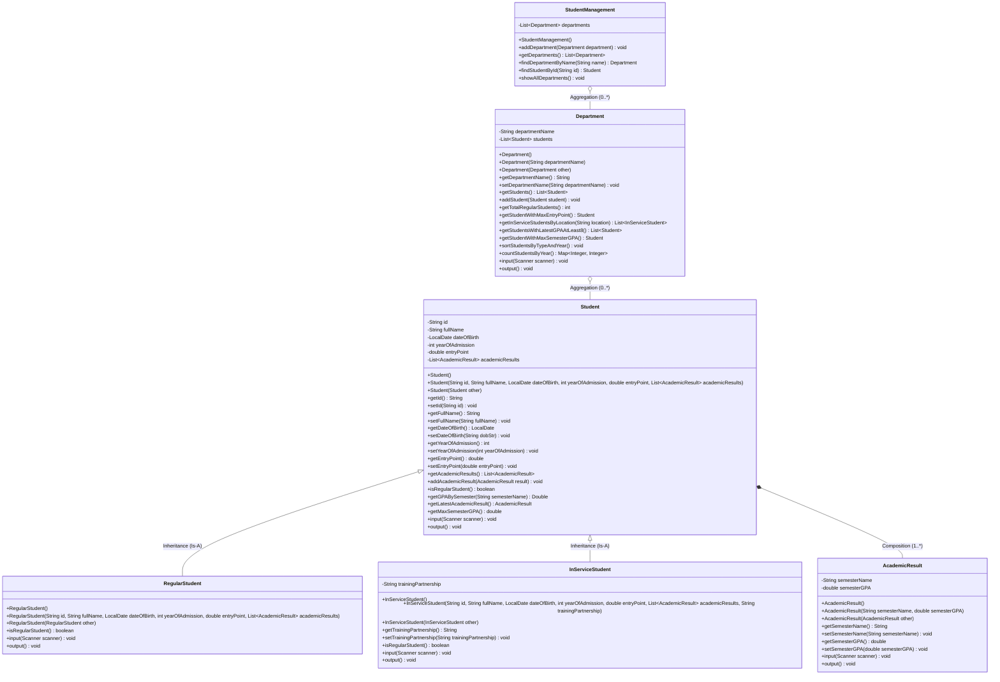

# Tổng hợp 15 Bài Tập Lập Trình Hướng Đối Tượng (OOP) - Java

Dự án này triển khai đầy đủ, chi tiết và chuẩn hóa toàn bộ 15 bài tập Lập trình hướng đối tượng (OOP) bằng ngôn ngữ Java, tuân thủ nghiêm ngặt các nguyên lý thiết kế OOP, xử lý Exception, và tổ chức code theo cấu trúc phân lớp rõ ràng.

---

## Mục lục
- [1. Danh mục bài tập](#1-danh-mục-bài-tập)
- [2. Cấu trúc thư mục nguồn](#2-cấu-trúc-thư-mục-nguồn)
- [3. Hướng dẫn biên dịch và chạy](#3-hướng-dẫn-biên-dịch-và-chạy)
- [4. Chi tiết lý thuyết & Thiết kế Bài 13 (Quản lý nhân viên)](#4-chi-tiết-lý-thuyết--thiết-kế-bài-13-quản-lý-nhân-viên)
- [5. Chi tiết Bài 14 (Tuyển dụng sinh viên tốt nghiệp)](#5-chi-tiết-bài-14-tuyển-dụng-sinh-viên-tốt-nghiệp)
- [6. Chi tiết & Class Diagram Bài 15 (Quản lý kết quả học tập)](#6-chi-tiết--class-diagram-bài-15-quản-lý-kết-quả-học-tập)

---

## 1. Danh mục bài tập

| Bài | Tên bài toán | Gói (Package) | Mô tả chính |
| :---: | :--- | :--- | :--- |
| **Bài 1** | Quản lý cán bộ sản xuất | `b1` | Quản lý công nhân, kỹ sư, nhân viên kế thừa từ lớp `CanBo`. Tìm kiếm theo họ tên. |
| **Bài 2** | Quản lý tài liệu thư viện | `b2` | Quản lý sách, tạp chí, báo kế thừa `TaiLieu`. Thêm, xóa theo mã, tìm theo loại. |
| **Bài 3** | Quản lý tuyển sinh đại học | `b3` | Quản lý thí sinh dự thi khối A, B, C kế thừa `ThiSinh`. Tìm kiếm theo SBD. |
| **Bài 4** | Quản lý khu phố & hộ dân | `b4` | Quản lý `Nguoi`, `HoGiaDinh`, `KhuPho`. Nhập n hộ dân, hiển thị thông tin chi tiết. |
| **Bài 5** | Quản lý khách sạn | `b5` | Quản lý khách thuê phòng loại A ($500), B ($300), C ($100). Tính tiền theo CMND. |
| **Bài 6** | Quản lý hồ sơ học sinh THPT | `b6` | Quản lý `HocSinh`. Lọc học sinh 20 tuổi, đếm học sinh 23 tuổi quê ở Đà Nẵng (DN). |
| **Bài 7** | Quản lý lương cán bộ giáo viên | `b7` | Quản lý `Nguoi`, `CBGV`. Tính lương thực lĩnh = Lương cứng + Thưởng - Phạt. |
| **Bài 8** | Quản lý mượn trả sách | `b8` | Quản lý `SinhVien`, `TheMuon`. Thêm, xóa theo mã phiếu mượn, hiển thị phiếu mượn. |
| **Bài 9** | Quản lý biên lai tiền điện | `b9` | Quản lý `KhachHang`, `BienLai`. Tính tiền = (Chỉ số mới - cũ) * 5. Thêm/sửa/xóa. |
| **Bài 10** | Xử lý văn bản | `b10` | Lớp `VanBan`: Đếm từ, đếm ký tự 'A'/'a', chuẩn hóa xâu (xóa khoảng trắng thừa). |
| **Bài 11** | Lớp Số phức | `b11` | Lớp `SoPhuc`: Nhập, hiển thị dạng `a + bi`, phép cộng và nhân 2 số phức. |
| **Bài 12** | Quản lý phương tiện giao thông | `b12` | Quản lý Ô tô, Xe máy, Xe tải kế thừa `PhuongTien`. Xóa theo ID, tìm theo hãng/màu. |
| **Bài 13** | Quản lý nhân viên công ty | `oop_employee_management` | Quản lý Experience, Fresher, Intern, Certificate. Áp dụng 4 tính chất OOP, custom exceptions, đọc/ghi file. |
| **Bài 14** | Tuyển dụng sinh viên đại học | `oop_student_management` | Xếp hạng GoodStudent, NormalStudent. Xét tuyển 11-15 chỉ tiêu, validate Exception. |
| **Bài 15** | Quản lý kết quả học tập SV | `oop_managing_academic_results` | Quản lý SV chính quy & tại chức, kết quả từng học kỳ, thống kê theo khoa/năm, Copy Constructor. |

---

## 2. Cấu trúc thư mục nguồn

```text
src/
├── b1/                             # Bài 1: Quản lý cán bộ
│   ├── CanBo.java
│   ├── CongNhan.java
│   ├── KySu.java
│   ├── NhanVien.java
│   ├── QLCB.java
│   └── Main.java
├── b2/                             # Bài 2: Quản lý tài liệu thư viện
│   ├── TaiLieu.java
│   ├── Sach.java
│   ├── TapChi.java
│   ├── Bao.java
│   ├── QuanLySach.java
│   └── Main.java
├── b3/                             # Bài 3: Tuyển sinh đại học
│   ├── ThiSinh.java
│   ├── ThiSinhKhoiA.java
│   ├── ThiSinhKhoiB.java
│   ├── ThiSinhKhoiC.java
│   ├── TuyenSinh.java
│   └── Main.java
├── b4/                             # Bài 4: Quản lý khu phố
│   ├── Nguoi.java
│   ├── HoGiaDinh.java
│   ├── KhuPho.java
│   └── Main.java
├── b5/                             # Bài 5: Quản lý khách sạn
│   ├── Nguoi.java
│   ├── Phong.java
│   ├── PhongA.java, PhongB.java, PhongC.java
│   ├── KhachThue.java
│   ├── KhachSan.java
│   └── Main.java
├── b6/                             # Bài 6: Quản lý học sinh THPT
│   ├── HocSinh.java
│   ├── QuanLyHocSinh.java
│   └── Main.java
├── b7/                             # Bài 7: Quản lý lương cán bộ giáo viên
│   ├── Nguoi.java
│   ├── CBGV.java
│   ├── QuanLyCBGV.java
│   └── Main.java
├── b8/                             # Bài 8: Quản lý thẻ mượn sách thư viện
│   ├── SinhVien.java
│   ├── TheMuon.java
│   ├── QuanLyTheMuon.java
│   └── Main.java
├── b9/                             # Bài 9: Biên lai tiền điện
│   ├── KhachHang.java
│   ├── BienLai.java
│   ├── QuanLyBienLai.java
│   └── Main.java
├── b10/                            # Bài 10: Xử lý văn bản
│   ├── VanBan.java
│   └── Main.java
├── b11/                            # Bài 11: Số phức
│   ├── SoPhuc.java
│   └── Main.java
├── b12/                            # Bài 12: Quản lý phương tiện giao thông
│   ├── PhuongTien.java
│   ├── Oto.java
│   ├── XeMay.java
│   ├── XeTai.java
│   ├── QLPTGT.java
│   └── Main.java
├── oop_employee_management/        # Bài 13: Hệ thống quản lý nhân viên
│   ├── controller/EmployeeController.java
│   ├── entity/
│   │   ├── Employee.java
│   │   ├── Experience.java
│   │   ├── Fresher.java
│   │   ├── Intern.java
│   │   └── Certificate.java
│   ├── enums/EmployeeType.java
│   ├── exception/
│   │   ├── BirthdayException.java
│   │   ├── EmailException.java
│   │   ├── FullNameException.java
│   │   └── PhoneException.java
│   ├── service/EmployeeManager.java
│   ├── validator/EmployeeValidator.java
│   ├── util/FileService.java
│   └── Main.java
├── oop_student_management/         # Bài 14: Quản lý tuyển dụng sinh viên tốt nghiệp
│   ├── entity/
│   │   ├── Student.java
│   │   ├── GoodStudent.java
│   │   └── NormalStudent.java
│   ├── exception/
│   │   ├── InvalidFullNameException.java
│   │   ├── InvalidDOBException.java
│   │   └── InvalidPhoneNumberException.java
│   ├── service/StudentManager.java
│   ├── validator/StudentValidator.java
│   └── Main.java
└── oop_managing_academic_results/  # Bài 15: Quản lý kết quả học tập sinh viên
    ├── AcademicResult.java
    ├── Student.java
    ├── RegularStudent.java
    ├── InServiceStudent.java
    ├── Department.java
    ├── StudentManagement.java
    └── Main.java
```

---

## 3. Hướng dẫn biên dịch và chạy

### 3.1 Biên dịch toàn bộ dự án
Mở terminal tại thư mục gốc của dự án (`d:\excercise-oop`) và chạy:

```bash
# Tạo thư mục đầu ra nếu chưa có
mkdir -p out/production/excercise-oop

# Biên dịch tất cả file .java trong src
javac -d out/production/excercise-oop src/b1/*.java src/b2/*.java src/b3/*.java src/b4/*.java src/b5/*.java src/b6/*.java src/b7/*.java src/b8/*.java src/b9/*.java src/b10/*.java src/b11/*.java src/b12/*.java src/oop_employee_management/**/*.java src/oop_student_management/**/*.java src/oop_managing_academic_results/*.java
```

### 3.2 Chạy từng bài tập
```bash
# Bài 1
java -cp out/production/excercise-oop b1.Main

# Bài 2
java -cp out/production/excercise-oop b2.Main

# Bài 3
java -cp out/production/excercise-oop b3.Main

# Bài 4
java -cp out/production/excercise-oop b4.Main

# Bài 5
java -cp out/production/excercise-oop b5.Main

# Bài 6
java -cp out/production/excercise-oop b6.Main

# Bài 7
java -cp out/production/excercise-oop b7.Main

# Bài 8
java -cp out/production/excercise-oop b8.Main

# Bài 9
java -cp out/production/excercise-oop b9.Main

# Bài 10
java -cp out/production/excercise-oop b10.Main

# Bài 11
java -cp out/production/excercise-oop b11.Main

# Bài 12
java -cp out/production/excercise-oop b12.Main

# Bài 13
java -cp out/production/excercise-oop oop_employee_management.Main

# Bài 14
java -cp out/production/excercise-oop oop_student_management.Main

# Bài 15
java -cp out/production/excercise-oop oop_managing_academic_results.Main
```

---

## 4. Chi tiết lý thuyết & Thiết kế Bài 13 (Quản lý nhân viên)

### 4.1 Bốn tính chất cốt lõi của OOP
1. **Tính bao đóng (Encapsulation):**
   - Mọi thuộc tính của các lớp (`id`, `fullName`, `birthDay`, `phone`, `email`,...) đều được khai báo với phạm vi truy cập `private`.
   - Các phương thức getter và setter công khai (`public`) kiểm soát truy cập và đảm bảo toàn vẹn dữ liệu.
2. **Tính kế thừa (Inheritance):**
   - Các lớp `Experience`, `Fresher`, `Intern` kế thừa (`extends`) từ lớp cha `Employee`, tái sử dụng toàn bộ thuộc tính và hành vi chung.
3. **Tính đa hình (Polymorphism):**
   - Phương thức trừu tượng `showInfo()` trong `Employee` được override trong từng lớp con để hiển thị thông tin đặc trưng của từng loại nhân viên.
   - Khi gọi `employee.showInfo()`, cơ chế Dynamic Binding sẽ tự động kích hoạt phương thức của đúng đối tượng thực tế tại runtime.
4. **Tính trừu tượng (Abstraction):**
   - Lớp `Employee` được định nghĩa là `abstract class` vì không thể tạo một thực thể nhân viên chung chung mà không rõ loại.
   - Phương thức trừu tượng `abstract void showInfo()` định nghĩa một khuôn mẫu hành vi mà mọi lớp con bắt buộc phải triển khai.

### 4.2 Các từ khóa và cơ chế trong Java
- **`super`:**
  - Dùng để gọi constructor của lớp cha (`super(id, fullName, ...)`) nhằm khởi tạo các thuộc tính kế thừa.
  - Dùng để gọi phương thức của lớp cha (`super.toString()`).
- **`this`:**
  - Tham chiếu đến chính đối tượng hiện tại, phân biệt thuộc tính của class và tham số truyền vào (`this.id = id`).
- **`static field` (`employeeCount`):**
  - Thuộc tính cấp độ lớp (class-level), dùng chung cho toàn bộ các đối tượng Employee, được tăng lên khi người dùng thêm nhân viên mới vào hệ thống.
- **Quan hệ `Is-A` và `Has-A`:**
  - `Is-A`: `Experience IS-A Employee`, `Fresher IS-A Employee`, `Intern IS-A Employee`.
  - `Has-A`: `Employee HAS-A List<Certificate>` (Một nhân viên sở hữu danh sách các chứng chỉ/bằng cấp).
- **Toán tử `instanceof` và Downcasting:**
  - `instanceof` kiểm tra xem một đối tượng tại runtime có phải là một kiểu cụ thể (hoặc lớp con của kiểu đó) hay không.
  - Ví dụ Downcasting an toàn với Pattern Matching trong Java:
    ```java
    if (existingEmployee instanceof Experience exp) {
        exp.setExpInYear(newExp.getExpInYear());
        exp.setProSkill(newExp.getProSkill());
    }
    ```

---

## 5. Chi tiết Bài 14 (Tuyển dụng sinh viên tốt nghiệp)

- **Các ngoại lệ tự định nghĩa:**
  - `InvalidFullNameException`: Ném ra khi họ tên < 10 ký tự hoặc > 50 ký tự hoặc để trống.
  - `InvalidDOBException`: Ném ra khi ngày sinh sai định dạng `dd/MM/yyyy` hoặc ở tương lai.
  - `InvalidPhoneNumberException`: Ném ra khi số điện thoại không đủ 10 chữ số hoặc không bắt đầu bằng một trong các đầu số: `090, 098, 091, 031, 035, 038`.
  - Bắt các lỗi không xác định khác với thông báo: `"Input files have unknow errors !!!"`.
- **Quy tắc xét tuyển (11 - 15 chỉ tiêu):**
  1. Lấy danh sách `GoodStudent`, sắp xếp theo `GPA` giảm dần; nếu trùng GPA xếp theo `fullName` tăng dần (A-Z).
  2. Nếu số lượng `GoodStudent` > chỉ tiêu tuyển: lấy đủ số lượng từ `GoodStudent`.
  3. Nếu số lượng `GoodStudent` <= chỉ tiêu: nhận hết `GoodStudent`, phần còn thiếu tuyển từ `NormalStudent`.
  4. Danh sách `NormalStudent` được ưu tiên theo: `entryTestScore` giảm dần $\rightarrow$ `englishScore` giảm dần $\rightarrow$ `fullName` tăng dần (A-Z).
- **Yêu cầu sắp xếp hiển thị:** Sử dụng `Collections.sort()` để sắp xếp giảm dần theo `fullName` và tăng dần theo `phoneNumber`.

---

## 6. Chi tiết & Class Diagram Bài 15 (Quản lý kết quả học tập)

### 6.1 Các tính năng chính
- 3 loại constructor cho tất cả các lớp: **Constructor mặc định**, **Constructor có tham số**, và **Constructor sao chép (Copy Constructor)** (hỗ trợ Deep Copy đối tượng và danh sách con).
- Quản lý sinh viên chính quy (`RegularStudent`) và sinh viên tại chức (`InServiceStudent`).
- Quản lý kết quả từng học kỳ (`AcademicResult`).
- Thống kê sinh viên điểm đầu vào cao nhất, ĐTB kỳ gần nhất $\ge 8.0$, ĐTB học kỳ cao nhất.
- Sắp xếp sinh viên: Tăng dần theo loại (Chính quy trước, tại chức sau) và Giảm dần theo năm vào học.
- Thống kê phân bố số lượng sinh viên theo từng năm vào học (`Map<Integer, Integer>`).

### 6.2 Class Diagram (Mermaid)


